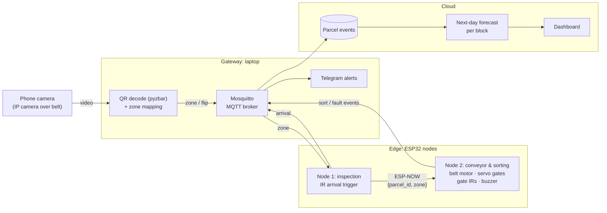

# ZoneSort: Automated Parcel Sorting for HDB Estates

> NUS CS3237 Introduction to Internet of Things · AY2026/27 Sem 1 · Group 3
> **Status:** 🟢 Building (before parts arrive) · **Proposal:** ✅ [submitted](docs/proposal/) · **Feedback:** [read it](docs/proposal/#feedback-on-the-proposal)

A courier loads parcels into a feeder. ZoneSort releases them one at a time, reads each QR label, and routes the parcel along a conveyor to **Zone A** (floors 1–5), **Zone B** (floors 6–10) or **Manual** (unreadable or unknown label). Every parcel is logged to the cloud, which forecasts next-day parcel volume per block so supervisors can plan how many couriers they need.

Sorting runs **locally on the ESP32s and never waits for the cloud**. If the zone lookup times out, the parcel goes to Manual.

## 👥 Team

| Member | Area | Main folders |
|---|---|---|
| Tan Chyn | Mechanical, servos & IR | [`hardware/`](hardware/) |
| Toh Xiang Yi Thomas | Firmware: ESP-NOW, Node 1, motor control | [`node1/`](node1/), [`node2/`](node2/) |
| Ng Ren Jie Daniel | Firmware: Node 2 tasks, gate logic, fail-safes | [`node2/`](node2/) |
| Loh Wern She | Scanning & gateway | [`gateway/`](gateway/) |
| Chang Shu Kai | Cloud, dashboard & ML | [`cloud/`](cloud/), [`ml/`](ml/) |

## 🗂️ Repository map

| Folder | What goes here |
|---|---|
| [`node1/`](node1/) | ESP32 #1, inspection node: IR arrival trigger, ESP-NOW link to Node 2, MQTT |
| [`node2/`](node2/) | ESP32 #2, conveyor & sorting node: belt motor, servo gates, gate IRs, fail-safes (FreeRTOS) |
| [`gateway/`](gateway/) | Laptop: QR decoding from the phone camera, zone mapping, MQTT broker, Telegram alerts |
| [`cloud/`](cloud/) | Parcel event schema, database, dashboard |
| [`ml/`](ml/) | Traffic simulator, next-day forecasting models, evaluation |
| [`hardware/`](hardware/) | CAD / 3D-print files, wiring & power plan, parts list, datasheets |
| [`docs/`](docs/) | Proposal, project brief, meeting notes, reports |
| [`data/`](data/) | Dataset descriptions (large files stay out of git) |

## 🏗️ System overview

Topic names and message payloads will be fixed in the event schema ([`cloud/`](cloud/)).

## 📅 Timeline & grading

| When | Deliverable | Weight |
|---|---|---|
| Mon 28 Sep, 23:59 | ✅ Project proposal (Canvas) | 10% |
| Week 9 | Check-in 1 + Peer Review 1 | 5% |
| Week 11 | Check-in 2 (with demo) | 5% |
| Fri 13 Nov | Final demo + presentation | 20% |
| Fri 13 Nov, 23:59 | Final report (≤ 20 pages) | 15% |
| Weeks 9 & 13 | Peer reviews (both completed) | 5% |

Full summary of the spec: [`docs/project-brief.md`](docs/project-brief.md)

## 🤝 How we work

- **Discussion & tasks:** use GitHub **Issues** (one per task/question) and the **Projects** board.
- **Code changes:** make a branch (`node2/gate-logic`, `ml/baseline` …) → open a **Pull Request** → someone else reviews → merge.
- **Meeting notes:** add a file to [`docs/meeting-notes/`](docs/meeting-notes/) using the template.
- **Each folder's README** explains how to build/run that part.
- **Never commit** Wi-Fi passwords, API keys or cloud credentials. Put them in `secrets.h` (firmware) or `.env` (Python); both are in `.gitignore`. Commit a `secrets.example.h` / `.env.example` instead.
