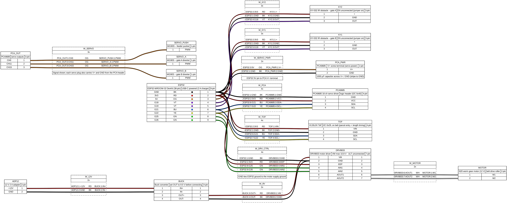

# Wiring

Pin maps and wiring diagrams for each ESP32.

## Node 2 (conveyor & sorting): confirmed pinout

Source: [`node2_wiring.yml`](node2_wiring.yml) (render with `wireviz node2_wiring.yml`).

Board: ESP32-WROOM-32 DevKit (38-pin) on an expansion hat. Hat label `Pn` = `GPIOn`. Code always uses GPIO numbers.

**Belt order:** pusher (CH0) → ToF → Gate A (G18 + CH11) → Gate B (G19 + CH15) → Manual (end of belt)

| Part | Pin | ESP32 / PCA9685 | Status |
|---|---|---|---|
| PCA9685 | VCC / GND | 3V3 / GND | ✅ |
| PCA9685 | SDA / SCL | G21 / G22 (I2C 0x40) | ✅ |
| PCA9685 | V+ screw terminal | ESP32 5V pin, 1000 µF cap across V+/GND | ✅ |
| VL53L0X ToF (on belt) | VIN / GND / SDA / SCL | 3V3 / GND / G21 / G22 (I2C 0x29) | ✅ |
| KY-032, Gate A | + / GND / OUT | 3V3 / GND / **G18** | ✅ |
| KY-032, Gate B | + / GND / OUT | 3V3 / GND / **G19** | ✅ |
| KY-032 | EN | unconnected (jumper on) | ✅ |
| Servo: pusher (MG90S) | plug | PCA **CH0** | ✅ |
| Servo: Gate A diverter (MG90S) | plug | PCA **CH11**: pass = 90° left, zone A = swing right | ✅ |
| Servo: Gate B diverter (MG90S) | plug | PCA **CH15**: pass = 90° right, zone B = swing left | ✅ |
| DRV8833 | AIN1 / AIN2 | G25 / G26 | ✅ forward tested at 5 V |
| DRV8833 | EEP / ULT | 3V3 / unconnected | ✅ |
| DRV8833 | AOUT1 / AOUT2 | N20 motor | ✅ |

Servo pulses: 2450 µs = 90° left, 1500 µs = centre, 550 µs = 90° right.

### Power

| Supply | Feeds | Notes |
|---|---|---|
| USB-C (2 A charger) | ESP32 → 3V3 rail and 5V pin | 3V3: PCA logic, ToF, KY-032 ×2. 5V pin: PCA V+ (servos) |
| 12 V 2 A adapter | Motor driver VM only | DRV8833 max is 10.8 V: buck converter set to ~9.5 V, or swap to TB6612FNG / L298N for full 12 V |
| GND | All grounds joined | ESP32, PCA, adapter −, motor driver |

### Spare pins
G17, G23, G27 (planned PWMA for a TB6612FNG), G32, G33.

### Avoid
- Hat +/− rails: some are dead
- G1 / G3 (TX/RX): breaks uploading
- G6–G11: internal flash
- G0, G2, G12, G15: boot strapping pins
- G34–G39: input only, no pull-ups
- 5 V on any GPIO (ESP32 pins are 3.3 V only), and 12 V into the DRV8833

## Hardware test sketch

[`../tests/node2_hw_test/node2_hw_test.ino`](../tests/node2_hw_test/node2_hw_test.ino) prints the ToF and both KY-032s live and lets you drive every servo from the Serial Monitor (115200):

| Type | Result |
|---|---|
| `A` | Gate A swings right (divert), Gate B pass |
| `B` | Gate B swings left (divert), Gate A pass |
| `M` | both gates pass |
| `P` | pusher pushes once |
| `T` | every servo in turn |

Libraries: Adafruit PWM Servo Driver, VL53L0X by Pololu.
